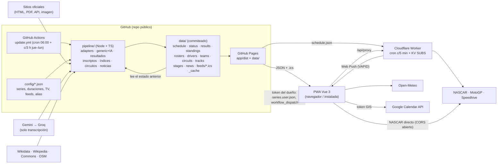
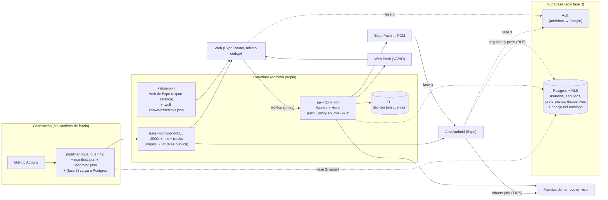
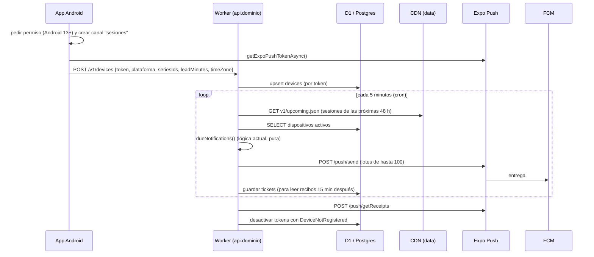

# Arquitectura: hoy y objetivo

Volver al [README](README.md).

## 1. Cómo funciona hoy

Puntos clave que condicionan la migración:

- **`data/` es a la vez salida y estado del pipeline.** `run.ts` lee el `schedule.json` y el `status.json`
  anteriores (para `changedAt`/`previousStartUtc`, para conservar series con error y lo que está fuera del
  horizonte), `_cache/*.json` (intentos de resultados, IA de la temporada siguiente, trazados, imágenes de
  noticias) y los resultados ya publicados (`collectExistingResults`). Cualquier destino nuevo de los datos tiene
  que resolver dónde vive ese estado.
- **App y datos se publican juntos** (mismo artefacto de Pages). Hoy un cambio de formato no rompe nada porque la
  app nueva llega con los datos nuevos. Con una app nativa, eso deja de ser cierto.
- **Los ids son estables y deterministas**: `stableHash` (FNV-1a 64 bits) para eventos y sesiones, slugs para
  series, pilotos (`driverId`), equipos (`teamId`) y circuitos (`circuitKey`). Es la mejor noticia para una base de
  datos: permite *upsert* idempotente sin tablas de correspondencia.
- **Volumen chico** (2026-11-14): 40 series, 553 eventos, 1.089 sesiones, 894 sesiones con resultados
  (24.738 filas), 3.287 filas de campeonatos, 1.770 inscriptos, 2.308 pilotos, 579 equipos, 171 circuitos,
  124 trazados, 266 noticias. `data/` pesa ~13 MB sin comprimir (`results/` 6,6 MB, `schedule.json` 1,2 MB).
  Cualquier plan gratis de base de datos sobra por años.
- **El Worker guarda todas las suscripciones en una sola clave de KV** y manda un `fetch` por aviso.

## 2. Arquitectura objetivo

La idea rectora: **cada pieza nueva se suma solo cuando la necesita una funcionalidad concreta**. La fase 1 no
tiene base de datos; la fase 3 sí, y aun así el catálogo se sigue leyendo del CDN.

## 3. Qué se reusa tal cual, qué se adapta y qué se reescribe

| Pieza | Destino | Detalle |
|---|---|---|
| `pipeline/` completo | **Tal cual** | Sigue corriendo en Actions. Se le **suman** salidas: `manifest.json`, `upcoming.json` (fase 1) y la carga a Postgres (fase 3). Ningún lector cambia. |
| `config/` | **Tal cual** | Sigue siendo la configuración versionada en git. |
| `shared/src/types.ts`, `schemas.ts`, `profiles.ts`, `drivers.ts` (tipos), `hash.ts`, `period.ts`, `time.ts`, `labels.ts`, `names.ts`, `circuits.ts`, `broadcast.ts`, `ics.ts`, `live*.ts` | **Tal cual** en la app Expo | TS puro con `luxon` y `zod`. Hay que verificar con un spike: imports con extensión `.ts`, el `import … with { type: 'json' }` de `drivers.ts` (lee `config/driver-aliases.json`), `BigInt` y `TextEncoder` en Hermes y `luxon` con zonas IANA en Hermes (ver [app-react-native.md](app-react-native.md#spike)). |
| `app/src/lib/*.ts` puros (agenda, grid, context, stages, search, recommend, podium, roster, teams, upcoming, season, seasonStats, countdown, format, conditions, circuitInfo, circuits, sources, standingsTables, onboarding, broadcast) y `gcal/{api,audit,mapping,sync}.ts`, `github/user-config.ts` | **Tal cual** | Conviene moverlos a un paquete `@dm/core` (o a `shared/`) para que los importen las dos apps sin rutas relativas cruzadas. |
| `app/src/lib/{data,storage,push,weather,download,clock,live}.ts`, `github/client.ts` | **Adaptar** | Separar la lógica pura de la plataforma (fetch con `BASE_URL`, `localStorage`, Service Worker, `document`). Ver la lista de tareas de la fase 0. |
| `app/src/stores/*.ts` (Pinia) | **Reemplazar el contenedor** | La lógica de carga y los getters se convierten en *hooks* de TanStack Query + selectores puros; las preferencias, en un store de Zustand con persistencia. |
| `app/src/views`, `components`, `App.vue`, `styles.css`, `tabStrip.ts`, `visible.ts`, `install.ts`, `appUpdate.ts` | **Reescribir** | Interfaz en React Native. El CSS se traduce a *tokens* de tema. |
| `worker/` | **Extender** | Se mantienen `due.ts` (lógica pura) y el proxy. Se agrega Expo Push, almacenamiento en D1, rutas versionadas `/v1/…` y, si crece, Hono. |
| `.github/workflows/update.yml` | **Extender** | Pasos nuevos: publicar en el CDN (si se sale de Pages), cargar en Postgres (fase 3), construir la web de Expo. |
| `public/push-handler.js` (Service Worker) | **Solo web** | Lo necesita la web de Expo para Web Push. |

## 4. Dónde vive cada cosa

| Qué | Fase 1 (sin base) | Fase 3 (con cuentas) | Notas |
|---|---|---|---|
| Recolección | GitHub Actions + `pipeline/` | Igual | Sin servidor propio. Repo público = minutos gratis. |
| Estado del pipeline (`_cache`, datos anteriores) | En el repo (`data/`), como hoy | Igual, o en R2 descargado al empezar cada corrida | Ver "Mudanza de los datos" abajo. |
| Catálogo (horarios, resultados, tablas, pilotos…) | JSON en `data.<dominio>/v1/` | **Igual** (fuente de lectura) + espejo en Postgres para consultas | El CDN no cobra egreso; Supabase gratis da 5 GB/mes. |
| Trazados (`tracks/{id}.json`) | Estático | Estático | Geometría que no se consulta: no va a la base. |
| `.ics` (`feeds/*.ics`) | Estático | Estático + (opcional) feed personal por usuario generado por el Worker | La suscripción webcal necesita una URL estable. |
| Bios e historial (`bios/*`) | Estático | Estático + espejo en Postgres | Cambian poco. |
| Preferencias (zona, tema, clima, ocultas) | En el dispositivo (Zustand + almacenamiento local) | Dispositivo + `profiles` en Postgres si el usuario inició sesión | |
| Seguidos (categorías, pilotos, equipos) | En el dispositivo | Postgres (`follows`), sincronizado | |
| Dispositivos para avisos | D1 (o KV mientras sean pocos) | Postgres (`devices`) | Con cuentas, una sola fuente de verdad. |
| Envío de avisos | Worker (cron c/5 min) | Igual; lee los dispositivos de Postgres | Expo Push para Android, Web Push para la web. |
| Tiempos en vivo | Android: directo a la fuente. Web: proxy del Worker | Igual | |
| Clima | Open-Meteo desde el dispositivo | Igual (o vía Worker con caché si es comercial) | Licencia: ver [publicacion-y-legal.md](publicacion-y-legal.md#open-meteo). |
| Exportar a calendario | Android: `expo-calendar` (calendario del teléfono) + webcal. Web: `.ics`, GIS y webcal | Igual | |
| Edición de categorías (dueño) | API de GitHub con token del dueño (como hoy) | Igual | No hace falta llevarlo a la base. |
| Web propia | `<dominio>` en Cloudflare (export estático de Expo) | Igual | `assetlinks.json` para App Links. |

## 5. Mudanza de los datos (cuándo y cómo salir de GitHub Pages)

No es urgente. Hay tres escalones, de menor a mayor esfuerzo:

1. **Dominio propio delante de Pages** (fase 1). `data.<dominio>` como dominio personalizado de un repo de Pages, o
   un Worker que reenvía a Pages con caché. La app solo conoce `data.<dominio>`: el día que cambie el origen, no
   hay que publicar una versión nueva de la app.
2. **Publicar también en R2** (si la app es pública o comercial). El workflow sube `data/` a un bucket R2 con
   dominio propio (con `wrangler r2 object put` o `rclone`), **sin dejar de commitear** `data/`: el pipeline sigue
   leyendo su estado del repo. Es el cambio mínimo que saca el tráfico de los usuarios de GitHub Pages.
3. **Dejar de commitear `data/`** (opcional, si el repo crece demasiado). El pipeline descarga el estado anterior
   desde R2 al empezar (`schedule.json`, `status.json`, `results/**`, `_cache/**`), corre igual que hoy y sube lo
   nuevo. Requiere una corrida a la vez (ya está: `concurrency: update-and-deploy`) y un respaldo diario (R2 tiene
   versionado de objetos opcional o se guarda un `.tar.gz` por día). Se pierde el historial de `git log data/`,
   que hoy sirve para depurar.

Recomendación: **escalón 1 en la fase 1; escalón 2 solo si la app es pública; escalón 3 solo si el tamaño del
repo molesta.**

## 6. Flujo de un aviso push (fase 2)

`upcoming.json` es nuevo y chico: el plan gratis de Workers da **10 ms de CPU por invocación**, y parsear un
`schedule.json` de 1,2 MB en cada corrida del cron puede pasarse (hoy funciona porque Cloudflare tolera excesos
ocasionales, pero no hay que depender de eso). La ventana de 5 minutos sin registro de "ya avisado" se mantiene,
pero conviene sumar una tabla `notifications_sent` con clave única (dispositivo, sesión) para no duplicar si el
cron se reintenta.

## 7. Flujo de tiempos en vivo

- **Android:** la app usa `liveUpstreams(seriesId)` igual que hoy, pero ignora `viaProxy` (no hay CORS): pide la
  URL oficial directo con su propio `User-Agent`. Se respeta `pollSeconds`. Si la fuente bloquea o cambia, la app
  cae al proxy.
- **Web:** igual que hoy, por `/v1/live/proxy?url=…` (lista cerrada `PROXY_ALLOWLIST`, caché de 5 s/60 s).
- **Riesgo:** si la app es pública, pedir APIs no documentadas (MotoGP pulselive, Speedhive) desde miles de
  teléfonos es más visible que desde un proxy con caché. Para una app pública conviene **usar siempre el proxy**
  (un pedido a la fuente cada 5 s, sin importar cuántos usuarios haya) y revisar los términos de cada fuente.

## 8. Riesgos de arquitectura

| Riesgo | Mitigación |
|---|---|
| Romper versiones viejas de la app al cambiar un JSON | Contrato `v1` solo aditivo; `v2/` en paralelo; `minAppVersion` en el manifiesto ([api.md](api.md)). |
| `shared/` no compila en Metro/Hermes | Spike en la fase 0 antes de comprometerse ([app-react-native.md](app-react-native.md#spike)). |
| Límites del Worker gratis (50 subpedidos, 10 ms CPU) | Lotes de 100 en Expo Push, `upcoming.json` chico; si no alcanza, Workers Paid (USD 5/mes). |
| Supabase gratis se pausa tras una semana sin actividad | La carga del pipeline cada pocas horas cuenta como actividad (verificarlo en la práctica); Pro (USD 25/mes) si es pública con usuarios reales. |
| Divergencia entre CDN y Postgres | Postgres es un espejo que se carga **desde los mismos archivos** ya validados con zod; el CDN sigue siendo la fuente de lectura. |
