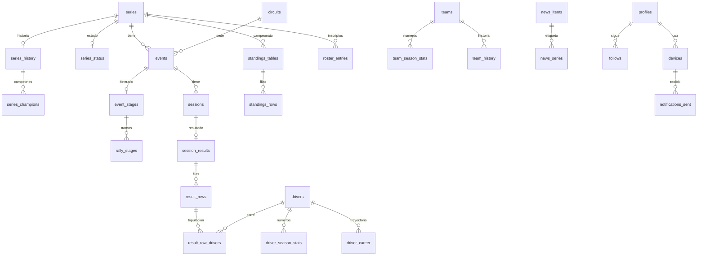

# Base de datos

Volver al [README](README.md). Datos de proveedores consultados el **2026-11-14** (fuentes al final).

## 1. ¿Hace falta una base? (no antes de tiempo)

Hoy **no**. El catálogo entero (horarios, resultados, tablas, pilotos, equipos, circuitos, noticias) lo genera el
pipeline cada pocas horas y se lee como archivos estáticos: es lo más barato, rápido y robusto que hay. Una base de
datos solo se justifica cuando aparece alguna de estas necesidades:

| Necesidad | ¿La cubren los JSON? | ¿Justifica la base? |
|---|---|---|
| Ver agenda, resultados, tablas, fichas | Sí | No |
| Seguir categorías/pilotos/equipos en **un** dispositivo | Sí (almacenamiento local) | No |
| Avisos push por dispositivo | Casi (D1/KV en el Worker) | No una base "grande": alcanza D1 |
| **Sincronizar lo seguido entre dispositivos** (teléfono + web) | No | **Sí** |
| **Cuentas de usuario** (Play Store exige borrado de cuenta) | No | **Sí** |
| Avisos calculados en el servidor por piloto o equipo, o de "terminó la carrera, ganó X" | Parcial | Sí, si se quiere hacer bien |
| Historial multi-temporada consultable ("todas las victorias de X desde 2026") | Difícil (archivos por temporada) | Sí, a mediano plazo |
| Panel de administración para corregir datos a mano | No (hoy se corrige en `config/`) | Opcional |

**Regla:** se crea la base en la fase 3, cuando se decida tener cuentas. Hasta entonces, este documento es el
diseño de referencia para que ese día sea un trabajo de días y no de semanas.

## 2. Principios del modelo

1. **Los JSON siguen siendo el contrato y la fuente de lectura del catálogo.** Postgres es un **espejo
   consultable** que se carga desde los mismos archivos ya validados con zod. Si la base se cae, la app sigue
   mostrando la agenda.
2. **Ids de texto, los mismos de hoy.** `stableHash` para eventos y sesiones, slugs para series, pilotos, equipos y
   circuitos. Permite `INSERT … ON CONFLICT DO UPDATE` sin tablas de correspondencia y que las URLs de la app
   (`/evento/:eventId`, `/piloto/:driverId`) no cambien.
3. **Normalizar lo que se consulta, `jsonb` para lo que solo se muestra.** `Source` (procedencia) va como `jsonb` en
   cada fila: siempre se muestra entera y nunca se filtra por sus campos. Igual las imágenes con atribución
   (`CircuitImage`/`CreditedImage`), condiciones medidas, terrenos de etapas y `alsoIn` de noticias.
4. **Lo derivado se recalcula, no se guarda como verdad.** `Driver.entries` (sale de las tablas), `lineups` (de los
   inscriptos), `recent` (de los resultados) y las estadísticas de temporada pueden ser **vistas** o tablas que el
   pipeline reescribe completas. Hoy el pipeline ya las calcula (`season-stats.ts`): se cargan tal cual.
5. **Horas en UTC (`timestamptz`), fechas locales del circuito como `date`**, igual que en los tipos.
6. **Nombres crudos + id resuelto.** Las filas de resultados, tablas e inscriptos guardan el nombre tal como lo
   publicó la fuente (`driver_raw`) **y** el id resuelto (`driver_id`), que puede ser nulo. Así un cambio en
   `config/driver-aliases.json` se aplica recalculando ids sin volver a leer fuentes.
7. **Temporada explícita.** `MotorEvent` no tiene campo de temporada (se deduce del año o de la temporada de
   invierno, p. ej. Asian Le Mans 2026-27 = 2026). Recomiendo sumar `season?: number` a `MotorEvent` en la fase 0
   (cambio aditivo): el pipeline ya lo conoce (`withSeriesSeason`).

## 3. Diagrama entidad-relación (resumen)



## 4. Esquema Postgres de referencia

> Diseño de referencia, no un archivo para ejecutar. Cuando se implemente, va como migraciones de Supabase
> (`supabase/migrations/*.sql`) y se generan los tipos con `supabase gen types typescript`. Todo en el esquema
> `public` para que lo exponga la API de Supabase; las tablas internas del pipeline pueden ir en un esquema
> `ingest` no expuesto.

### 4.1 Tipos enumerados

Se mapean 1:1 a los tipos de `shared/src/types.ts`. Alternativa: `text` + `check`, más fácil de extender (un
`ALTER TYPE … ADD VALUE` no se puede deshacer). Recomiendo **`text` + `check`** para los que cambian seguido
(`series_group`, `session_type`) y `enum` para los estables.

```sql
create type strategy        as enum ('adapter', 'generic');
create type series_origin   as enum ('default', 'user', 'discovered');
create type series_state    as enum ('ok', 'stale', 'error', 'disabled');
create type sessions_status as enum ('published', 'pending');
create type surface         as enum ('asfalto', 'tierra', 'nieve', 'arena', 'mixto');
create type stage_kind      as enum ('shakedown','prologo','especial','superespecial','power','enlace','descanso');
create type news_kind       as enum ('oficial', 'medio');
create type follow_kind     as enum ('series', 'driver', 'team');
create type push_platform   as enum ('android', 'ios', 'web');
create type push_kind       as enum ('expo', 'webpush', 'fcm');
```

### 4.2 Catálogo

```sql
-- Series (Series). config/series.*.json sigue siendo la verdad; esto es el espejo publicado.
create table series (
  id              text primary key check (id ~ '^[a-z0-9]+(-[a-z0-9]+)*$'),
  name            text not null,
  short_name      text not null,
  grp             text not null check (grp in ('f1-fia','moto','usa','gt-endurance','asia','rally','argentina','otros')),
  checklist_item  int,
  official_urls   text[] not null default '{}',
  roster_urls     text[] not null default '{}',
  strategy        strategy not null,
  adapter         text,
  origin          series_origin not null,
  enabled         boolean not null,
  color           text,
  updated_at      timestamptz not null default now()
);

-- Circuitos (CircuitInfo). El trazado (tracks/{id}.json) NO va acá: sigue estático.
create table circuits (
  id             text primary key,               -- circuitKey(nombre)
  name           text not null,
  wikidata       text check (wikidata ~ '^Q\d+$'),
  lat            double precision check (lat between -90 and 90),
  lon            double precision check (lon between -180 and 180),
  coords_approx  boolean not null default false,
  city           text,
  length_m       numeric,
  turns          int,
  opened         int,
  capacity       int,
  elevation_m    numeric,
  direction      text,
  lap_record     jsonb,                           -- CircuitLapRecord
  summary        text,
  summary_lang   text,
  website        text,
  wikipedia_url  text,
  photo          jsonb,                           -- CircuitImage (url, credit, license, page…)
  map            jsonb,
  has_track      boolean not null default false,
  checked_at     timestamptz not null
);

-- Eventos (MotorEvent)
create table events (
  id               text primary key,              -- stableHash(serie, temporada, nombre/ronda)
  series_id        text not null references series(id) on delete cascade,
  season           int  not null,                 -- nuevo: ver principio 7
  name             text not null,
  round            int,
  circuit_name     text not null,                 -- como lo publica la fuente ("A confirmar")
  circuit_id       text references circuits(id),  -- circuitKey(circuit_name), puede ser nulo
  country          text not null default '',
  tz               text not null,                 -- zona IANA
  date_start       date not null,
  date_end         date not null check (date_end >= date_start),
  sessions_status  sessions_status not null,
  kind             text check (kind in ('test')),
  surface          surface,
  stage_count      int check (stage_count >= 0),
  source           jsonb not null,                -- Source
  updated_at       timestamptz not null default now()
);
create index events_series_season_idx on events (series_id, season, date_start);
create index events_dates_idx         on events (date_start, date_end);
create index events_circuit_idx       on events (circuit_id);

-- Sesiones (Session)
create table sessions (
  id                    text primary key,
  event_id              text not null references events(id) on delete cascade,
  series_id             text not null references series(id) on delete cascade,
  type                  text not null check (type in ('practica','clasificacion','sprint','serie','carrera','warmup','etapa','otro')),
  name                  text not null,
  original_name         text,
  start_utc             timestamptz not null,
  end_utc               timestamptz not null check (end_utc > start_utc),
  end_estimated         boolean not null,
  local_start_text      text,
  broadcast             text[] not null default '{}',
  broadcast_is_default  boolean not null,
  changed_at            timestamptz,
  previous_start_utc    timestamptz,
  has_results           boolean not null default false,
  source                jsonb not null,
  updated_at            timestamptz not null default now()
);
create index sessions_start_idx        on sessions (start_utc);
create index sessions_series_start_idx on sessions (series_id, start_utc);
create index sessions_event_idx        on sessions (event_id);

-- Resultados (SessionResult + ResultRow)
create table session_results (
  session_id  text primary key references sessions(id) on delete cascade,
  conditions  jsonb,                               -- SessionConditions
  source      jsonb not null,
  updated_at  timestamptz not null
);

create table result_rows (
  session_id   text not null references session_results(session_id) on delete cascade,
  idx          int  not null,                      -- orden en la fuente
  pos          int check (pos > 0),
  status       text,                               -- DNF, DNS, DSQ, NC…
  number       text,
  driver_raw   text not null,                      -- "A / B" en tripulaciones
  team_raw     text,
  team_id      text,                               -- teamId(team_raw); sin FK: puede no estar en teams
  vehicle      text,
  laps         int check (laps >= 0),
  time         text,
  gap          text,
  best_lap     text,
  points       numeric,
  class        text,
  class_pos    int check (class_pos > 0),
  primary key (session_id, idx)
);

-- Tripulaciones: un renglón por piloto de la fila (splitDriverNames + driverId).
create table result_row_drivers (
  session_id  text not null,
  idx         int  not null,
  driver_id   text not null,
  ord         int  not null,                       -- orden dentro de la tripulación
  primary key (session_id, idx, driver_id),
  foreign key (session_id, idx) references result_rows(session_id, idx) on delete cascade
);
create index result_row_drivers_driver_idx on result_row_drivers (driver_id);

-- Campeonatos (StandingsFile)
create table standings_tables (
  series_id   text not null references series(id) on delete cascade,
  season      int  not null,
  title       text not null,                       -- "Pilotos", "Equipos", "Clase 2"…
  ord         int  not null,
  updated_at  timestamptz not null,
  source      jsonb not null,
  primary key (series_id, season, title)
);

create table standings_rows (
  series_id  text not null,
  season     int  not null,
  title      text not null,
  pos        int  not null check (pos > 0),
  name       text not null,
  driver_id  text,                                 -- si es tabla de pilotos (isDriverTable)
  team_id    text,                                 -- si es tabla de equipos
  team       text,
  number     text,
  points     numeric not null,
  wins       int,
  country    text,
  primary key (series_id, season, title, pos, name),
  foreign key (series_id, season, title) references standings_tables on delete cascade
);
create index standings_rows_driver_idx on standings_rows (driver_id);

-- Inscriptos (RosterFile)
create table rosters (
  series_id   text not null references series(id) on delete cascade,
  season      int  not null,
  updated_at  timestamptz not null,
  source      jsonb not null,
  primary key (series_id, season)
);

create table roster_entries (
  series_id   text not null,
  season      int  not null,
  idx         int  not null,
  driver_raw  text not null,
  driver_id   text,
  team_raw    text,
  team_id     text,
  number      text,
  vehicle     text,
  class       text,
  country     text,
  primary key (series_id, season, idx),
  foreign key (series_id, season) references rosters on delete cascade
);
create index roster_entries_driver_idx on roster_entries (driver_id);
create index roster_entries_team_idx   on roster_entries (team_id);

-- Pilotos (Driver + DriverBio). entries/lineups/recent se derivan con vistas.
create table drivers (
  id           text primary key,                   -- driverId (con sufijo en homónimos)
  name         text not null,
  country      text,
  wikidata     text,
  summary      jsonb,                               -- BioSummary {text, lang, url}
  birth_date   date,
  birth_place  text,
  nationality  text,
  photo        jsonb,                               -- CreditedImage
  links        jsonb,                               -- [{label, url}]
  bio_updated_at timestamptz,
  updated_at   timestamptz not null default now()
);
create index drivers_name_trgm on drivers using gin (name gin_trgm_ops);  -- requiere pg_trgm (búsqueda)

create table driver_aliases (                       -- espejo de config/driver-aliases.json
  alias_id   text primary key,
  driver_id  text not null references drivers(id) on delete cascade
);

create table driver_season_stats (                  -- DriverSeasonStats (lo calcula el pipeline)
  driver_id    text not null references drivers(id) on delete cascade,
  series_id    text not null references series(id) on delete cascade,
  season       int  not null,
  races        int not null, wins int not null, podiums int not null,
  top5         int not null, top10 int not null, dnfs int not null,
  best_pos     int, avg_pos numeric(4,1), poles int, sprint_wins int,
  overall      boolean not null default false,
  primary key (driver_id, series_id, season)
);

create table driver_career (                        -- CareerSeason (historial, tanda 5)
  driver_id  text not null references drivers(id) on delete cascade,
  season     int  not null,
  series     text not null,                          -- nombre como se conoce
  series_id  text references series(id),
  team       text,
  pos        int, points numeric, races int, wins int, podiums int, poles int,
  champion   boolean not null default false,
  source     text not null check (source in ('wikidata','wikipedia','oficial','app')),
  primary key (driver_id, season, series)
);
-- titles = select … from driver_career where champion (no hace falta tabla aparte).

-- Equipos (Team + TeamBio)
create table teams (
  id          text primary key,                      -- teamId
  name        text not null,
  wikidata    text,
  summary     jsonb,
  logo        jsonb,
  founded     int,
  base        text,
  country     text,
  principal   text,
  website     text,
  titles      jsonb,                                  -- BioTitle[] (pocos, solo se muestran)
  bio_updated_at timestamptz,
  updated_at  timestamptz not null default now()
);

create table team_history (
  team_id    text not null references teams(id) on delete cascade,
  series     text not null,
  series_id  text references series(id),
  from_year  int  not null,
  to_year    int,
  primary key (team_id, series, from_year)
);

create table team_season_stats (
  team_id    text not null references teams(id) on delete cascade,
  series_id  text not null references series(id) on delete cascade,
  season     int  not null,
  races int not null, wins int not null, podiums int not null, dnfs int not null,
  best_pos int, poles int, sprint_wins int,
  overall    boolean not null default false,
  primary key (team_id, series_id, season)
);

-- Historia de categorías (SeriesHistory)
create table series_history (
  series_id         text primary key references series(id) on delete cascade,
  wikidata          text,
  summary           jsonb,
  logo              jsonb,
  founded           int,
  organizer         text,
  records           jsonb,                           -- [{label, value}]
  champions_source  jsonb,                           -- {url, title}
  updated_at        timestamptz not null
);

create table series_champions (
  series_id  text not null references series_history(series_id) on delete cascade,
  season     int  not null,
  idx        int  not null default 0,                -- varias líneas por temporada (clases)
  driver     text, driver_id text,
  team       text, team_id   text,
  vehicle    text,
  note       text,
  primary key (series_id, season, idx)
);

-- Rally y rally raid (EventStagesFile + RallyStage)
create table event_stages (
  event_id          text primary key references events(id) on delete cascade,
  series_id         text not null references series(id) on delete cascade,
  surface           surface,
  surface_note      text,
  competitive_km    numeric,
  total_km          numeric,
  route_map_url     text,
  route_map_credit  text,
  source            jsonb not null,
  updated_at        timestamptz not null
);

create table rally_stages (
  event_id          text not null references event_stages(event_id) on delete cascade,
  idx               int  not null,
  code              text not null,                   -- "SS1", "Etapa 3"
  name              text not null,
  kind              stage_kind not null,
  date              date not null,
  start_utc         timestamptz,
  local_start_text  text,
  distance_km       numeric,
  liaison_km        numeric,
  total_km          numeric,
  surface           surface,
  terrain           jsonb,                            -- StageTerrain[]
  map_url           text,
  note              text,
  cancelled         boolean not null default false,
  session_id        text references sessions(id) on delete set null,
  primary key (event_id, idx)
);

-- Noticias (NewsItem). Se guardan ~60 días; el resto se borra.
create table news_items (
  id            text primary key,                     -- hash del link
  title         text not null,
  url           text not null unique,
  source        text not null,
  source_kind   news_kind not null,
  published_at  timestamptz not null,
  image         text,
  summary       text,
  lang          text,
  also_in       jsonb                                  -- NewsAlternate[]
);
create index news_published_idx on news_items (published_at desc);

create table news_series (
  news_id    text not null references news_items(id) on delete cascade,
  series_id  text not null,
  primary key (news_id, series_id)
);
create index news_series_series_idx on news_series (series_id);

-- Estado de las fuentes (SeriesStatus) y corridas del pipeline
create table series_status (
  series_id            text primary key references series(id) on delete cascade,
  state                series_state not null,
  last_attempt         timestamptz not null,
  last_success         timestamptz,
  message              text,
  source_url           text,
  standings_available  boolean not null,
  timetables_found     int,
  timetables_due       int
);

create table pipeline_runs (
  id            bigint generated always as identity primary key,
  started_at    timestamptz not null,
  finished_at   timestamptz,
  git_sha       text,                                  -- commit de datos que se cargó
  data_version  text,                                  -- generatedAt de schedule.json
  counts        jsonb,                                 -- {events, sessions, drivers…}
  ok            boolean
);

-- Competencias descubiertas (DiscoveredItem)
create table discovered (
  series_id        text primary key,
  name             text not null,
  official_url     text not null,
  first_seen       date not null,
  next_event_date  date,
  source           jsonb not null
);
```

### 4.3 Vistas derivadas (lo que hoy arma `buildIndexFromData`)

```sql
-- Driver.entries: línea de campeonato por categoría (temporada vigente de cada serie).
create view driver_entries as
select r.driver_id, r.series_id, r.season, nullif(r.title, 'Pilotos') as table_title,
       r.pos, r.points, r.wins, r.number, r.team
from standings_rows r
where r.driver_id is not null;

-- Driver.lineups: inscripciones.
create view driver_lineups as
select e.driver_id, e.series_id, e.season, e.team_raw as team, e.number, e.vehicle, e.class
from roster_entries e
where e.driver_id is not null;

-- Driver.recent: últimas carreras y sprints.
create view driver_recent as
select d.driver_id, s.series_id, s.event_id, s.id as session_id, s.start_utc, rr.pos, rr.status
from result_row_drivers d
join result_rows rr using (session_id, idx)
join sessions s on s.id = d.session_id
where s.type in ('carrera', 'sprint');
```

Si alguna vista se pone lenta, se convierte en `materialized view` y el pipeline la refresca al terminar la carga.
Con el volumen actual (25 mil filas de resultados por temporada) no hace falta.

### 4.4 Usuarios (fase 3)

Con Supabase, `auth.users` lo administra Supabase Auth. Todo lo del usuario cuelga de `profiles.id`.

```sql
create table profiles (
  id            uuid primary key references auth.users(id) on delete cascade,
  display_name  text,
  time_zone     text not null default 'America/Argentina/Buenos_Aires',
  theme         text not null default 'system' check (theme in ('system','dark','light')),
  show_weather  boolean not null default true,
  hidden_series text[] not null default '{}',
  created_at    timestamptz not null default now(),
  updated_at    timestamptz not null default now()
);

-- Lo que sigue el usuario. Sin FK a drivers/teams: un piloto puede desaparecer del índice y volver la temporada
-- siguiente (hoy la app conserva lo seguido aunque no figure). Se guarda la "foto" (nombre y categorías) igual
-- que FollowedDriver, para armar la agenda sin descargar el índice.
create table follows (
  user_id     uuid not null references profiles(id) on delete cascade,
  kind        follow_kind not null,
  target_id   text not null,
  name        text,                                   -- driver/team: nombre al seguirlo
  series_ids  text[] not null default '{}',           -- driver/team: sus categorías
  position    int  not null default 0,                -- orden elegido
  created_at  timestamptz not null default now(),
  primary key (user_id, kind, target_id)
);

create table notification_prefs (
  user_id        uuid primary key references profiles(id) on delete cascade,
  enabled        boolean not null default false,
  lead_minutes   int not null default 30 check (lead_minutes in (5,15,30,60,120)),
  notify_results boolean not null default false,      -- futuro: "terminó la carrera"
  quiet_from     time,                                -- futuro: no molestar
  quiet_to       time,
  updated_at     timestamptz not null default now()
);

-- Dispositivos para avisos. user_id nulo = dispositivo sin cuenta (registrado por el Worker).
create table devices (
  id            uuid primary key default gen_random_uuid(),
  user_id       uuid references profiles(id) on delete cascade,
  platform      push_platform not null,
  push_kind     push_kind not null,
  token         text not null unique,                 -- ExponentPushToken[…] o endpoint de Web Push
  webpush_keys  jsonb,                                -- {p256dh, auth} solo web
  time_zone     text not null,
  lead_minutes  int not null default 30,
  series_ids    text[] not null default '{}',         -- solo sin cuenta (con cuenta salen de follows)
  app_version   text,
  last_seen_at  timestamptz not null default now(),
  disabled_at   timestamptz,                          -- DeviceNotRegistered / 404 / 410
  created_at    timestamptz not null default now()
);
create index devices_active_idx on devices (disabled_at) where disabled_at is null;

-- Evita avisos duplicados si el cron se reintenta, y guarda el ticket para leer el recibo.
create table notifications_sent (
  device_id   uuid not null references devices(id) on delete cascade,
  session_id  text not null,
  kind        text not null default 'start',          -- 'start' | 'result'
  sent_at     timestamptz not null default now(),
  ticket_id   text,
  receipt     text,                                   -- ok | error:<detalle>
  primary key (device_id, session_id, kind)
);
-- Limpieza: borrar filas de más de 7 días (pg_cron o el mismo Worker).

-- Pedidos de borrado de cuenta hechos desde la web (requisito de Play Store).
create table account_deletion_requests (
  id            bigint generated always as identity primary key,
  user_id       uuid,
  email         text,
  requested_at  timestamptz not null default now(),
  processed_at  timestamptz
);
```

Con usuarios anónimos de Supabase (*anonymous sign-ins*) cada instalación tiene un `auth.uid()` desde el primer
uso sin pedir email; al "crear cuenta" se vincula una identidad (Google) al mismo usuario y no se pierde nada. Así
`devices.user_id` nunca es nulo y la tabla `devices` sin cuenta deja de hacer falta.

## 5. Seguridad: Row Level Security (Supabase)

En Supabase, las tablas de `public` se exponen por la API REST/GraphQL con la clave pública (`anon`). **Toda tabla
tiene que tener RLS activado**; sin políticas, nadie lee nada (salvo la clave de servicio, que se saltea RLS y solo
la usan el pipeline y el Worker).

```sql
-- Catálogo: lectura pública, escritura solo con service_role (pipeline).
alter table series   enable row level security;
create policy "catalogo lectura" on series for select to anon, authenticated using (true);
-- … igual para events, sessions, session_results, result_rows, result_row_drivers, standings_*, rosters,
--   roster_entries, drivers, teams, circuits, *_stats, *_history, series_champions, event_stages, rally_stages,
--   news_items, news_series, series_status.
-- Sin políticas de insert/update/delete: solo service_role escribe.

-- Tablas internas: RLS activado y SIN políticas (nadie desde la app).
alter table pipeline_runs enable row level security;
alter table driver_aliases enable row level security;
alter table account_deletion_requests enable row level security;

-- Datos del usuario: cada uno solo lo suyo. "(select auth.uid())" evita evaluarlo fila por fila.
alter table profiles enable row level security;
create policy "perfil propio" on profiles for all to authenticated
  using (id = (select auth.uid())) with check (id = (select auth.uid()));

alter table follows enable row level security;
create policy "seguidos propios" on follows for all to authenticated
  using (user_id = (select auth.uid())) with check (user_id = (select auth.uid()));

alter table notification_prefs enable row level security;
create policy "avisos propios" on notification_prefs for all to authenticated
  using (user_id = (select auth.uid())) with check (user_id = (select auth.uid()));

-- Dispositivos: el usuario ve y borra los suyos; el alta la hace el Worker (valida el token) con service_role.
alter table devices enable row level security;
create policy "dispositivos propios (leer)"  on devices for select to authenticated using (user_id = (select auth.uid()));
create policy "dispositivos propios (borrar)" on devices for delete to authenticated using (user_id = (select auth.uid()));

alter table notifications_sent enable row level security;  -- sin políticas: solo el Worker
```

Otras reglas:

- **Índices en las columnas de las políticas** (`follows.user_id`, `devices.user_id`): las claves primarias ya los
  cubren salvo `devices`, que necesita `create index on devices (user_id)`.
- **Nunca** poner la clave `service_role` en la app ni en la web. Va como secreto de GitHub Actions (pipeline) y de
  Wrangler (Worker).
- Borrar la cuenta = borrar `auth.users` (con la API de administración, desde el Worker o una Edge Function): las
  `on delete cascade` limpian `profiles`, `follows`, `notification_prefs` y `devices`.
- Revisar el *Security Advisor* del panel de Supabase antes de publicar (marca tablas sin RLS).

## 6. Carga desde el pipeline (de JSON a Postgres)

### 6.1 Dónde se engancha

Un paso nuevo **al final** de `update.yml`, después de "Guardar datos" y antes del build. No toca `run.ts`: lee los
archivos ya escritos en `data/` (validados con zod) y los carga. Ventajas: si la carga falla, la app sigue
funcionando con los JSON; se puede volver a correr sola (`npm run db:load`) y cargar el historial completo de
`data/` la primera vez.

```yaml
# Referencia para update.yml (no implementado)
- name: Cargar en la base
  if: env.DATABASE_URL != ''
  run: npm run db:load -w pipeline
  env:
    DATABASE_URL: ${{ secrets.DATABASE_URL }}   # pooler de Supabase, ver 6.4
  continue-on-error: true                       # la base es un espejo: no frena la publicación
```

### 6.2 Estrategia: upsert por serie, en una transacción

Para cada serie con datos nuevos:

1. `begin`
2. *Upsert* de `series`, `events`, `sessions` con `insert … on conflict (id) do update set … where (fila) is
   distinct from (excluded)`: si nada cambió, no se escribe (menos WAL, menos ruido en `updated_at`).
3. **Borrado acotado** de lo que desapareció **solo para esa serie y esa temporada**:
   `delete from sessions where series_id = $1 and id <> all($2)`. Importante: el pipeline **conserva** los datos de
   las series con error y lo que está fuera del horizonte; como la carga lee el `schedule.json` resultante (que ya
   los incluye), el borrado es seguro. No usar `--only` como criterio de borrado.
4. Resultados por evento: reemplazo completo (`delete from session_results where session_id = any(…)` + insert),
   porque las filas no tienen id propio y un resultado corregido puede cambiar el orden.
5. Tablas e inscriptos: reemplazo completo por `(series_id, season)`.
6. `commit`

Después, global: pilotos y equipos (upsert por id), estadísticas (reemplazo completo, son pocas), noticias (upsert
y borrado de lo de más de 60 días), circuitos, bios, estados. Al final, una fila en `pipeline_runs`.

Para no reprocesar todo en cada corrida: comparar el `updatedAt`/hash de cada archivo con el de la última carga
(guardado en una tabla `ingest.files (path, sha256, loaded_at)`) y cargar solo lo que cambió. El `manifest.json`
propuesto en [api.md](api.md#manifiesto) ya trae ese hash.

### 6.3 Dos formas de implementarlo

| Opción | Cómo | Pros | Contras |
|---|---|---|---|
| **A. SQL directo desde Node** (recomendada) | `postgres` (porsager) o `pg` en `pipeline/src/db/`, una transacción por serie | Transacciones reales, rápido, sin depender de la API REST | Conexión por el *pooler* (IPv4) |
| B. Función en la base (RPC) | `create function ingest_series(payload jsonb)` que hace todo el upsert; el pipeline la llama con `supabase-js` por HTTPS | Lógica de carga en un solo lugar, HTTPS | SQL/PLpgSQL más largo de mantener; payloads grandes |

### 6.4 Conexión desde GitHub Actions

Las conexiones **directas** a Supabase son solo IPv6 (salvo el complemento IPv4, pago), y los *runners* de GitHub
Actions usan IPv4. Hay que usar el **pooler compartido** (Supavisor), que es IPv4 en todos los planes:

- Modo sesión: `aws-<n>-<region>.pooler.supabase.com:5432`, usuario `postgres.<project-ref>` → para la carga (una
  transacción larga por serie).
- Modo transacción: mismo host, puerto `6543` → para el Worker (conexiones cortas). Desde Workers conviene usar la
  API REST de Supabase o Hyperdrive de Cloudflare.

### 6.5 Primera carga (historia)

Un script `db:backfill` que recorre `git log -- data/schedule.json` y carga cada versión **solo** si se quiere el
historial de cambios de horario. En general alcanza con cargar el estado actual: `data/` ya tiene la temporada
completa.

### 6.6 Bios, alias y correcciones

- `config/driver-aliases.json` → `driver_aliases` en cada carga (es chico).
- Si cambia un alias, recalcular `driver_id` en `result_row_drivers`, `standings_rows` y `roster_entries` con un
  `update … from driver_aliases`. Por eso se guardan los nombres crudos.

## 7. Qué sigue siendo archivo estático

| Archivo | Por qué no va a la base |
|---|---|
| `tracks/{id}.json` | Geometría SVG (decenas de KB por circuito) que no se consulta: se dibuja. CDN con caché larga. |
| `feeds/*.ics` | Los calendarios suscriptos piden una URL fija y la vuelven a pedir cada pocas horas: estático es perfecto. Un `.ics` **personal** (lo seguido por cada usuario) lo puede generar el Worker con `buildIcs` de `shared/` en la fase 3. |
| `schedule.json`, `results/**`, `standings/**`, etc. | Se siguen publicando: son la fuente de lectura de la app (y el respaldo si la base falla). |
| `_cache/**` | Estado interno del pipeline; no le interesa a nadie más. |
| Imágenes (fotos, mapas, logos) | Se enlazan desde Commons o sitios oficiales; no se copian (ver lo legal). |

## 8. Proveedores comparados (planes gratis al 2026-11-14)

| | **Supabase** | **Neon** | **Cloudflare D1** | **Firebase (Spark)** |
|---|---|---|---|---|
| Motor | Postgres | Postgres (serverless) | SQLite | Firestore (NoSQL documentos) |
| Almacenamiento gratis | 500 MB por proyecto | 1 GB por proyecto (20 GB en la cuenta) | 5 GB en total | 1 GiB |
| Lecturas/escrituras | Sin cupo por operación (límite de CPU/RAM compartida) | 100 CU-hora por proyecto por mes | 5 M filas leídas y 100 mil escritas **por día** | 50 mil lecturas y 20 mil escrituras **por día** |
| Egreso | 5 GB + 5 GB cacheado por mes | 5 GB por proyecto | Sin costo de egreso | 10 GiB/mes |
| Auth incluida | Sí, 50 mil MAU | Sí (Neon Auth), 60 mil MAU | No (hay que sumar Better Auth u otro) | Sí, 50 mil MAU |
| Pausa / arranque en frío | **Se pausa tras 1 semana sin actividad**; 2 proyectos activos | Escala a cero tras 5 min (arranque en frío de ~cientos de ms) | No | No |
| Seguridad por fila | RLS de Postgres | RLS de Postgres (con Neon Auth/Data API) | En el código del Worker | Reglas de seguridad de Firestore |
| Plan pago más chico | Pro desde USD 25/mes (8 GB, 250 GB egreso, sin pausa, USD 10 de cómputo) | Launch: pago por uso (USD 0,106/CU-h, USD 0,35/GB-mes); ~USD 15/mes una base chica intermitente | Workers Paid USD 5/mes (25 mil M filas leídas, 50 M escritas por mes) | Blaze: pago por uso |
| Encaje con este proyecto | **Muy bueno**: SQL relacional como el modelo, Auth + RLS + panel, tipos TS generados | Bueno: Postgres puro y sin pausas; auth menos integrada | **Muy bueno para dispositivos sin cuentas** (vive junto al Worker); flojo como base principal con usuarios | Flojo: el modelo es relacional (resultados ↔ pilotos ↔ series); FCM gratis es su punto fuerte, pero Expo ya lo usa por detrás |

### Recomendación

- **Fase 2 (avisos sin cuentas):** **D1** en el mismo Worker para la tabla `devices` (+ `notifications_sent`).
  Gratis, sin pausas, sin otra cuenta. Esquema igual al de 4.4 con tipos SQLite.
- **Fase 3 (cuentas):** **Supabase**. Se migran los dispositivos de D1 a Postgres (son pocos) y el catálogo se
  carga como espejo. Si la pausa por inactividad o el egreso molestan y no se usa Supabase Auth, **Neon** es el
  reemplazo directo (mismo SQL).
- Si se decide **no** tener cuentas nunca: quedarse con D1 y los JSON. No hace falta Postgres.

## 9. Respaldo y operación

- No contar con las copias de seguridad del plan gratis de Supabase (las diarias con retención son del plan Pro;
  verificarlo en el panel al crear el proyecto): correr `pg_dump` semanal desde Actions y guardarlo como artefacto
  o en R2. El catálogo, de todos modos, se puede reconstruir desde `data/`.
- Los datos de usuarios **no** se pueden reconstruir: respaldo diario cuando haya usuarios reales (o Pro, que trae
  copias diarias).
- Migraciones con la CLI de Supabase (`supabase migration new`, `supabase db push`) versionadas en el repo, en una
  carpeta `supabase/` en la raíz.

## Fuentes (consultadas el 2026-11-14)

- Supabase, precios: <https://supabase.com/pricing>
- Supabase, conexión y pooler (IPv4/IPv6): <https://supabase.com/docs/guides/database/connecting-to-postgres>
- Neon, precios: <https://neon.com/pricing>
- Cloudflare D1, precios: <https://developers.cloudflare.com/d1/platform/pricing/>
- Cloudflare Workers y KV, precios y límites: <https://developers.cloudflare.com/workers/platform/pricing/>,
  <https://developers.cloudflare.com/workers/platform/limits/>
- Firebase, precios: <https://firebase.google.com/pricing>
